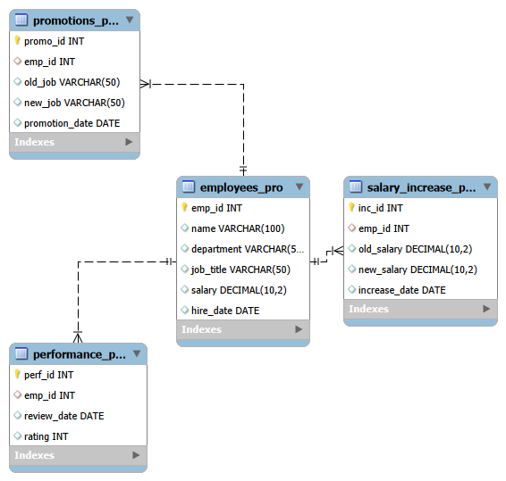

# HR Analytics Database Project

## Overview

This project is a relational database system developed using MySQL to manage and analyze Human Resources (HR) data.

The database focuses on organizing employee information, performance evaluations, promotions, and salary increases.

---

## Technologies Used

- MySQL
- SQL
- Database Design
- Entity Relationship Diagram (ERD)

---

## Project Objectives

- Design a structured HR database.
- Manage employee records efficiently.
- Track employee performance.
- Store promotion history.
- Analyze salary changes.

---

## Database Structure

The database contains four main tables:

### 1. employees_pro

Stores basic employee information:

- Employee ID
- Name
- Department
- Job Title
- Salary
- Hire Date

### 2. performance_pro

Stores employee performance reviews:

- Performance ID
- Employee ID
- Review Date
- Rating

### 3. promotions_pro

Stores employee promotion records:

- Promotion ID
- Employee ID
- Old Job
- New Job
- Promotion Date

### 4. salary_increase_pro

Stores salary increase information:

- Increase ID
- Employee ID
- Old Salary
- New Salary
- Increase Date

---

## Database Diagram

---

## SQL Features

The project includes:

- Database creation
- Table creation
- Data insertion
- Joins between tables
- Data analysis queries
- Employee performance analysis

---

## How to Run

1. Install MySQL Workbench.
2. Open `HR_Analytics.sql`.
3. Execute the SQL script.
4. Explore tables and run queries.

---

## Author

Norah Assiry
